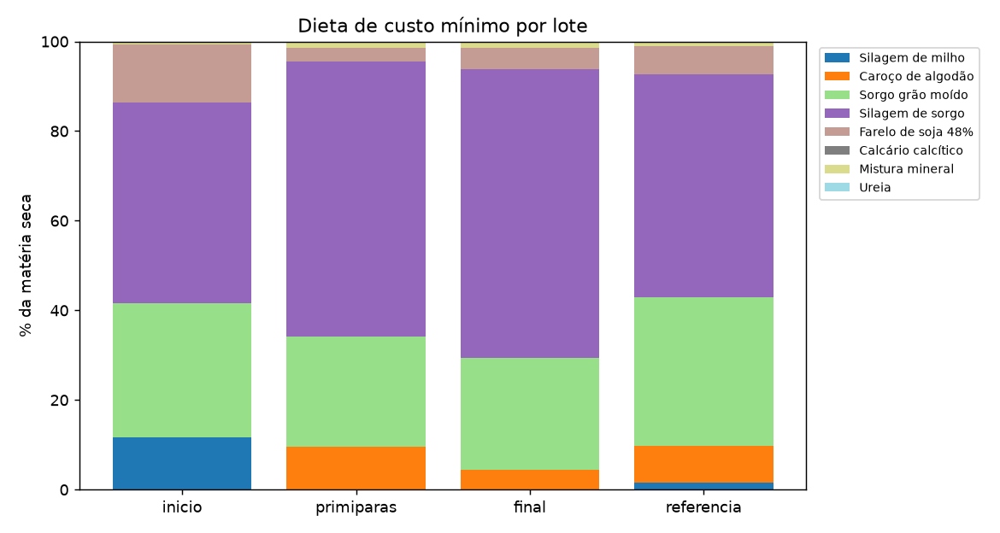
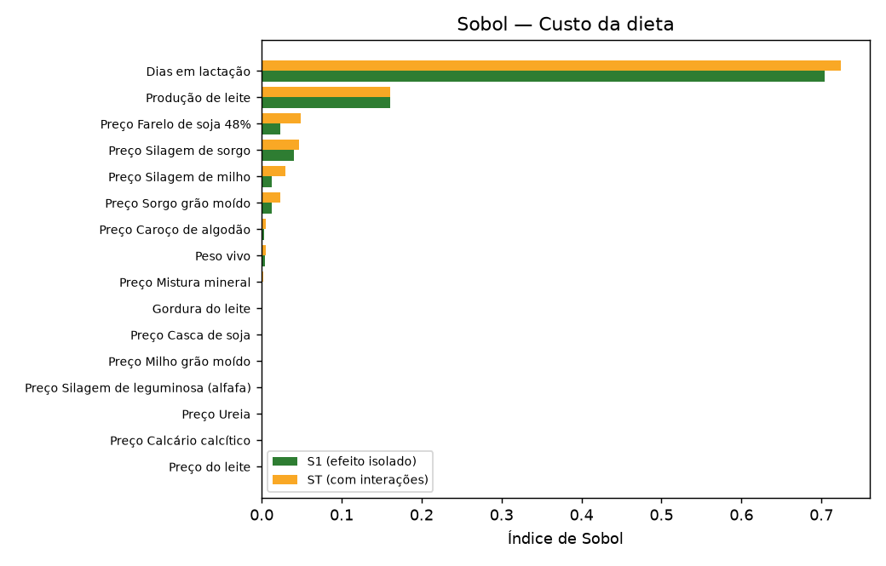
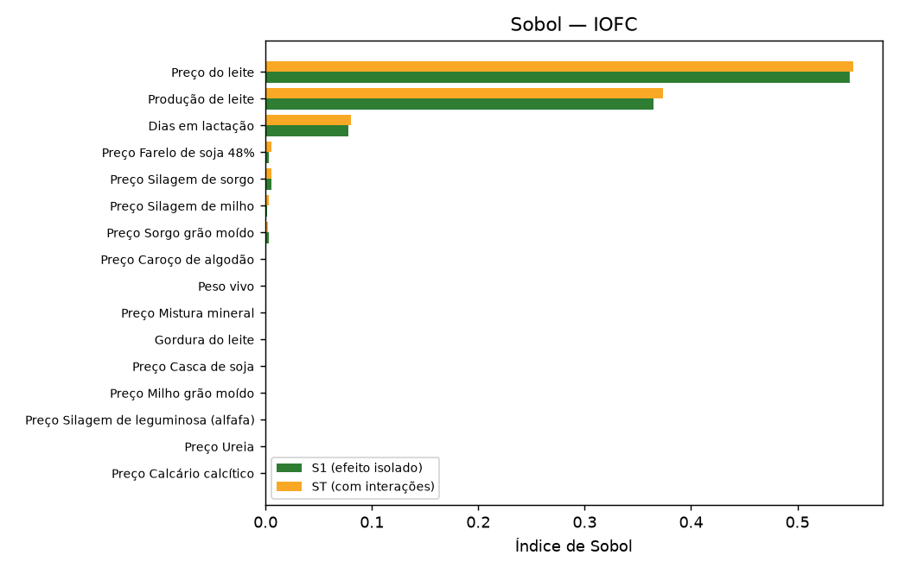
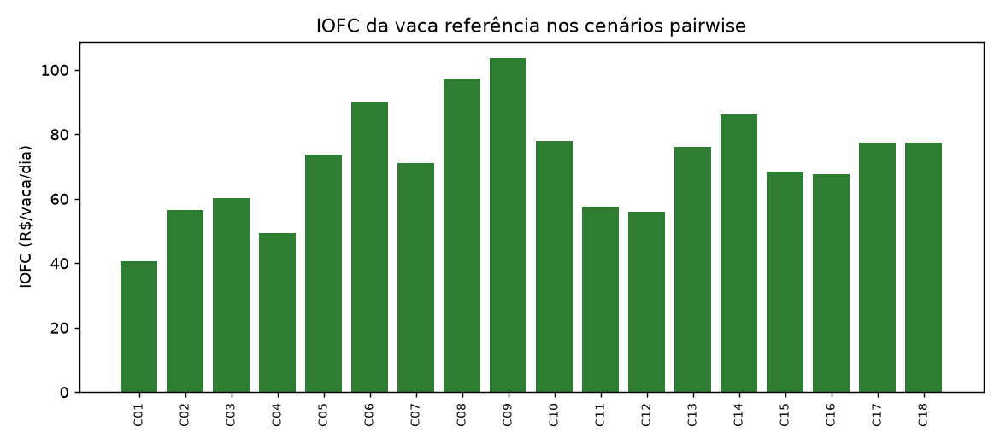
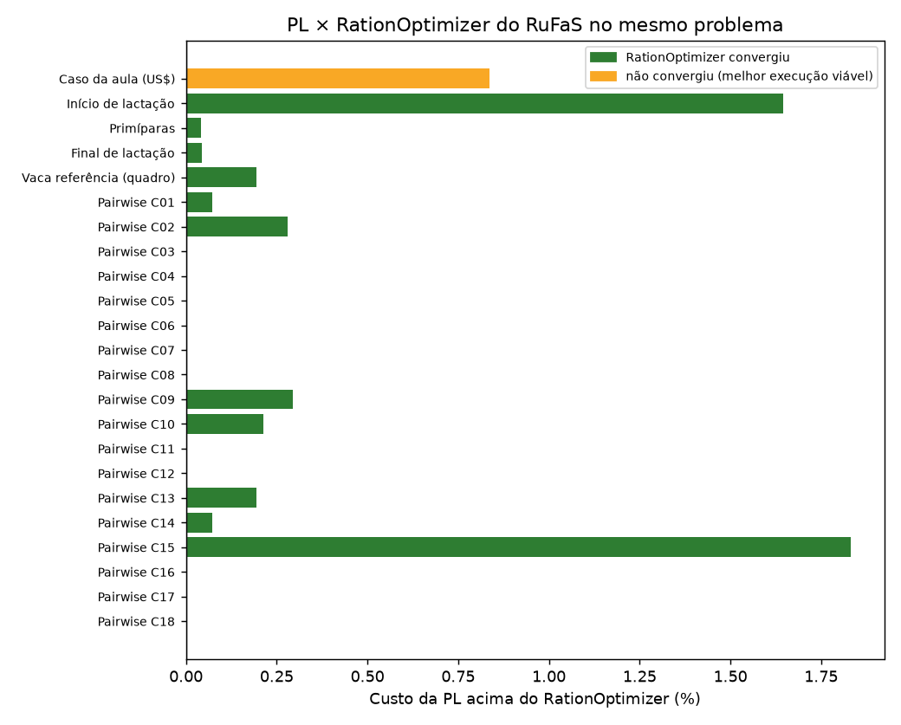

# Otimização de dieta — go_campo_dourado_ifg

Gerado em 30/10/2026 00:37 pelo módulo `otimizacao_dieta` (padrão NASEM, preço do leite R$ 2,50/kg, câmbio R$ 5,40/US$).

> Preços são valores de referência para estudo. Atualize `config_otimizacao.json` com cotações locais.

## 1. Exigências por lote (NASEM 2021, calculadas pelo RuFaS)

| Lote | Vacas | PV | Parto | DEL | Leite (kg) | CMS (kg) | ELl (Mcal) | PM (g) | Ca (g) | P (g) |
|---|---|---|---|---|---|---|---|---|---|---|
| Início de lactação | 30 | 680 kg | 2 | 45 | 38,0 | 24,61 | 48,54 | 2.944 | 61,6 | 59,8 |
| Primíparas | 15 | 600 kg | 1 | 120 | 30,0 | 21,36 | 34,72 | 1.867 | 51,1 | 50,0 |
| Final de lactação | 20 | 720 kg | 3 | 250 | 25,0 | 22,67 | 33,13 | 1.791 | 48,4 | 46,4 |
| Vaca referência (quadro) | 35 | 750 kg | 2 | 130 | 40,0 | 26,81 | 43,63 | 2.447 | 66,6 | 64,3 |

## 2. Dieta de custo mínimo

| Ingrediente (kg MS/vaca/dia) | R$/kg MS | Início de lactação | Primíparas | Final de lactação | Vaca referência (quadro) |
|---|---|---|---|---|---|
| Silagem de milho | R$ 0,71 | 3,12 (11,6%) | — | — | 0,37 (1,5%) |
| Caroço de algodão | R$ 1,31 | — | 1,86 (9,5%) | 0,83 (4,4%) | 2,01 (8,3%) |
| Sorgo grão moído | R$ 1,03 | 8,00 (29,9%) | 4,81 (24,6%) | 4,64 (24,9%) | 8,00 (33,1%) |
| Silagem de sorgo | R$ 0,70 | 12,00 (44,8%) | 12,00 (61,3%) | 12,00 (64,4%) | 12,00 (49,6%) |
| Farelo de soja 48% | R$ 2,24 | 3,46 (12,9%) | 0,62 (3,2%) | 0,89 (4,8%) | 1,52 (6,3%) |
| Calcário calcítico | R$ 0,40 | — | — | — | 0,03 (0,1%) |
| Mistura mineral | R$ 4,50 | 0,20 (0,7%) | 0,20 (1,0%) | 0,20 (1,1%) | 0,20 (0,8%) |
| Ureia | R$ 3,54 | — | 0,07 (0,4%) | 0,07 (0,4%) | 0,04 (0,2%) |
| **CMS total** |  | **26,78** | **19,56** | **18,62** | **24,17** |
| **Custo (R$/vaca/dia)** |  | **R$ 27,51** | **R$ 18,33** | **R$ 17,39** | **R$ 24,00** |

**Vaca referência (quadro): a dieta no formato do quadro da aula** (MN = matéria natural, o que vai no cocho):

| Ingrediente | MS do alimento | kg MS/vaca/dia | kg MN/vaca/dia | R$/t MS | R$/t MN | R$/vaca/dia |
|---|---|---|---|---|---|---|
| Silagem de sorgo | 28,7% | 12,00 | 41,78 | R$ 700 | R$ 201 | R$ 8,40 |
| Sorgo grão moído | 88,9% | 8,00 | 9,00 | R$ 1.030 | R$ 916 | R$ 8,24 |
| Caroço de algodão | 91,4% | 2,01 | 2,20 | R$ 1.310 | R$ 1.197 | R$ 2,64 |
| Farelo de soja 48% | 89,3% | 1,52 | 1,70 | R$ 2.240 | R$ 2.000 | R$ 3,41 |
| Silagem de milho | 35,4% | 0,37 | 1,04 | R$ 710 | R$ 251 | R$ 0,26 |
| Mistura mineral | 99,5% | 0,20 | 0,20 | R$ 4.500 | R$ 4.476 | R$ 0,90 |
| Ureia | 99,0% | 0,04 | 0,04 | R$ 3.540 | R$ 3.505 | R$ 0,15 |
| Calcário calcítico | 100,0% | 0,03 | 0,03 | R$ 400 | R$ 400 | R$ 0,01 |
| **Total** |  | **24,17** | **55,99** |  |  | **R$ 24,00** |

No cocho, a ração pesa 56,0 kg por vaca por dia. A otimização é feita em matéria seca porque as exigências NASEM e a composição dos alimentos estão em base seca; o custo é o mesmo nas duas bases.

**Conferência pelo motor do RuFaS.** A dieta de cada lote foi avaliada pelas funções de restrição originais do `RationOptimizer` (NASEM, vaca em lactação). Valor ≥ 0 = atendida.

| Restrição do RuFaS | Início de lactação | Primíparas | Final de lactação | Vaca referência (quadro) |
|---|---|---|---|---|
| calcium_constraint | 0,585 | 2,081 | 4,272 | 0,000 |
| phosphorus_constraint | 9,915 | 0,000 | 0,000 | 0,000 |
| protein_constraint_lower | 0,000 | -0,000 | -0,000 | -0,000 |
| protein_constraint_upper | 1.471,970 | 933,313 | 895,687 | 1.223,718 |
| NDF_constraint_lower | 10,618 | 19,439 | 18,982 | 13,133 |
| NDF_constraint_upper | 9,382 | 0,561 | 1,018 | 6,867 |
| forage_NDF_constraint | 17,354 | 22,768 | 24,680 | 16,191 |
| fat_constraint | 3,830 | 2,284 | 3,092 | 2,413 |
| DMI_constraint_upper | 5,213 | 8,206 | 10,853 | 10,689 |
| DMI_constraint_lower | 9,553 | 4,610 | 2,750 | 5,400 |
| NASEM_net_energy_constraint | -0,000 | 0,000 | 0,000 | 0,000 |
| **Todas atendidas?** | sim | sim | sim | sim |

A comparação com o otimizador original do RuFaS (RationOptimizer), resolvendo o mesmo problema, está na seção 8.

## 3. Avaliação econômica

| Lote | Dieta | Leite | CMS | Custo | Receita | IOFC | Custo/kg leite | Atende o RuFaS? |
|---|---|---|---|---|---|---|---|---|
| Início de lactação | ótima | 38,0 | 26,78 | R$ 27,51 | R$ 95,00 | R$ 67,49 | R$ 0,724 | sim |
| Início de lactação | atual (GO) | 38,0 | 24,61 | R$ 32,98 | R$ 95,00 | R$ 62,02 | R$ 0,868 | não: protein_constraint_lower, NASEM_net_energy_constraint |
| Primíparas | ótima | 30,0 | 19,56 | R$ 18,33 | R$ 75,00 | R$ 56,67 | R$ 0,611 | sim |
| Primíparas | atual (GO) | 30,0 | 21,36 | R$ 28,63 | R$ 75,00 | R$ 46,37 | R$ 0,954 | sim |
| Final de lactação | ótima | 25,0 | 18,62 | R$ 17,39 | R$ 62,50 | R$ 45,11 | R$ 0,696 | sim |
| Final de lactação | atual (GO) | 25,0 | 22,67 | R$ 30,39 | R$ 62,50 | R$ 32,11 | R$ 1,215 | sim |
| Vaca referência (quadro) | ótima | 40,0 | 24,17 | R$ 24,00 | R$ 100,00 | R$ 76,00 | R$ 0,600 | sim |
| Vaca referência (quadro) | atual (GO) | 40,0 | 26,81 | R$ 35,94 | R$ 100,00 | R$ 64,06 | R$ 0,898 | sim |

**Rebanho em lactação (100 vacas):** IOFC de R$ 6.436,92/dia com a dieta ótima contra R$ 5.440,44/dia com a dieta atual do GO_campo_dourado, valorizada pelos mesmos preços. Diferença de R$ 996,49/dia, ou **R$ 363.718 por ano**. Custo alimentar: R$ 0,656/kg de leite (ótima) × R$ 0,941/kg (atual).

> Atenção: a dieta atual não atende todas as restrições do RuFaS em: inicio: protein_constraint_lower, NASEM_net_energy_constraint. No simulador, o RuFaS reduziria a produção de leite desses lotes; o IOFC acima assume a produção cheia e por isso favorece a dieta atual.

**A mesma comparação com uma hipótese trocada de cada vez** (economia potencial calculada pelo modelo, não economia observada):

| Hipótese | Custo ótima (R$/dia) | Custo atual (R$/dia) | Redução | IOFC a mais por ano | Dieta atual falha em |
|---|---|---|---|---|---|
| RuFaS 1.0.5, como está | R$ 2.288,08 | R$ 3.284,56 | −30,34% | R$ 363.718 | inicio |
| Sem a exigência de gestação da vaca não prenhe (provável erro do RuFaS 1.0.5) | R$ 2.126,74 | R$ 3.284,56 | −35,25% | R$ 422.605 | — |
| Perdas de energia fixas na CMS prevista | R$ 2.292,26 | R$ 3.284,56 | −30,21% | R$ 362.192 | inicio |
| CMS fixada na prevista (±0,1%) | R$ 2.376,35 | R$ 3.284,56 | −27,65% | R$ 331.498 | inicio |

**Custo marginal do leite** (ração adicional para 1 kg a mais de leite, com a exigência recalculada):

| Lote | Custo marginal (R$/kg leite) | Margem sobre o preço do leite |
|---|---|---|
| Início de lactação | R$ 0,424 | R$ 2,076 |
| Primíparas | R$ 0,457 | R$ 2,043 |
| Final de lactação | R$ 0,483 | R$ 2,017 |
| Vaca referência (quadro) | R$ 0,454 | R$ 2,046 |

## 4. Leitura do quadro final do Simplex (vaca referência)

A PL da última iteração foi resolvida também por um Simplex tabular de duas fases (`go_campo_dourado_ifg/otimizacao_dieta/simplex.py`), que chegou ao mesmo ótimo do HiGHS (R$ 24,001842 × R$ 24,001842). O quadro completo está em `quadro_final_simplex.csv`; abaixo, o que ele diz sobre o negócio.

**Variáveis na base ótima** (as que têm valor no quadro final):

| Variável básica | Valor |
|---|---|
| Calcário calcítico | 0,0269 |
| Caroço de algodão | 2,0138 |
| Farelo de soja 48% | 1,5204 |
| Silagem de milho | 0,3666 |
| Silagem de sorgo | 12,0000 |
| Sorgo grão moído | 8,0000 |
| Ureia | 0,0415 |
| excesso sobre cms_min | 5,3997 |
| excesso sobre fdn_forragem | 3,9132 |
| excesso sobre fdn_min | 3,1741 |
| folga de cms_max | 10,6886 |
| folga de fdn_max | 1,6598 |
| folga de gordura_max | 0,5833 |
| folga de pm_max | 1.223,7175 |
| folga do limite máx. de Calcário calcítico | 0,2731 |
| folga do limite máx. de Caroço de algodão | 0,9862 |
| folga do limite máx. de Casca de soja | 6,0000 |
| folga do limite máx. de Farelo de soja 48% | 6,4796 |
| folga do limite máx. de Milho grão moído | 12,0000 |
| folga do limite máx. de Mistura mineral | 0,6000 |
| folga do limite máx. de Silagem de leguminosa (alfafa) | 10,0000 |
| folga do limite máx. de Silagem de milho | 19,6334 |
| folga do limite máx. de Ureia | 0,1085 |
| proteína microbiana (variável auxiliar) | 1.984,7299 |

**Preços-sombra (duais) e faixa de validade:**

| Restrição | Sentido | Lado direito | Unid. | Preço-sombra (R$/unid.) | Válido de | até |
|---|---|---|---|---|---|---|
| Cálcio absorvível | >= | 66,601 | g | 0,00127 | 57,651 | 157,381 |
| Fósforo absorvível | >= | 64,344 | g | 0,12334 | 59,794 | 65,514 |
| Proteína metabolizável (mínimo) | >= | 2.447,435 | g | 0,00491 | 2.351,950 | 2.569,745 |
| Proteína microbiana limitada pelo NDT | <= | 0,000 | g | -0,00220 | -76,416 | 81,244 |
| Proteína microbiana limitada pela PDR | <= | 0,000 | g | -0,00094 | -130,749 | 127,331 |
| Consumo de MS mínimo | >= | 18,770 | kg | 0,00000 | −∞ | 24,169 |
| Consumo de MS máximo | <= | 34,858 | kg | 0,00000 | 24,169 | +∞ |
| Energia líquida de lactação (NASEM) | >= | 43,628 | Mcal | 0,10547 | 43,037 | 47,570 |
| Limite máximo de Silagem de sorgo | <= | 12,000 | kg MS | -0,07689 | 3,283 | 12,570 |
| Limite máximo de Sorgo grão moído | <= | 8,000 | kg MS | -0,01460 | 6,275 | 8,444 |

**Intervalos de otimalidade dos preços e custos reduzidos:**

| Ingrediente | Situação | Preço | Preço mín. | Preço máx. | Custo reduzido |
|---|---|---|---|---|---|
| Silagem de milho | básica | R$ 0,71 | R$ 0,69 | R$ 0,95 | 0,0000 |
| Silagem de sorgo | básica | R$ 0,70 | −∞ | R$ 0,78 | 0,0000 |
| Silagem de leguminosa (alfafa) | não básica | R$ 1,20 | R$ 0,92 | +∞ | 0,2769 |
| Milho grão moído | não básica | R$ 1,25 | R$ 0,93 | +∞ | 0,3243 |
| Sorgo grão moído | básica | R$ 1,03 | −∞ | R$ 1,04 | 0,0000 |
| Casca de soja | não básica | R$ 1,00 | R$ 0,73 | +∞ | 0,2720 |
| Farelo de soja 48% | básica | R$ 2,24 | R$ 2,15 | R$ 2,70 | 0,0000 |
| Caroço de algodão | básica | R$ 1,31 | R$ 1,20 | R$ 1,56 | 0,0000 |
| Ureia | básica | R$ 3,54 | R$ 0,67 | R$ 4,15 | 0,0000 |
| Calcário calcítico | básica | R$ 0,40 | R$ -0,02 | R$ 5,05 | 0,0000 |
| Mistura mineral | não básica | R$ 4,50 | R$ 2,46 | +∞ | 2,0444 |

**Interpretação para a gestão:**

- **Cálcio absorvível é uma restrição ativa (gargalo).** Cada g de cálcio absorvível a mais na exigência custa R$ 0,0013 por vaca por dia (preço-sombra). Esse valor vale enquanto a exigência ficar entre 57,65 e 157,38 g; fora dessa faixa a combinação de ingredientes muda e o preço-sombra precisa ser recalculado.
- **Fósforo absorvível é uma restrição ativa (gargalo).** Cada g de fósforo absorvível a mais na exigência custa R$ 0,1233 por vaca por dia (preço-sombra). Esse valor vale enquanto a exigência ficar entre 59,79 e 65,51 g; fora dessa faixa a combinação de ingredientes muda e o preço-sombra precisa ser recalculado.
- **Proteína metabolizável (mínimo) é uma restrição ativa (gargalo).** Cada 100 g de proteína metabolizável a mais na exigência custa R$ 0,4907 por vaca por dia (preço-sombra). Esse valor vale enquanto a exigência ficar entre 2.351,95 e 2.569,74 g; fora dessa faixa a combinação de ingredientes muda e o preço-sombra precisa ser recalculado.
- *Proteína microbiana limitada pelo NDT* está ativa (preço-sombra R$ -0,00220 por g): a síntese de proteína microbiana no rúmen está no limite desse fator, então ingredientes que elevem esse limite barateiam a proteína metabolizável.
- *Proteína microbiana limitada pela PDR* está ativa (preço-sombra R$ -0,00094 por g): a síntese de proteína microbiana no rúmen está no limite desse fator, então ingredientes que elevem esse limite barateiam a proteína metabolizável.
- **Energia líquida de lactação (NASEM) é uma restrição ativa (gargalo).** Cada Mcal de ELl a mais na exigência custa R$ 0,1055 por vaca por dia (preço-sombra). Esse valor vale enquanto a exigência ficar entre 43,04 e 47,57 Mcal; fora dessa faixa a combinação de ingredientes muda e o preço-sombra precisa ser recalculado.
- **O limite de Silagem de sorgo está travando a dieta.** Liberar 1 kg de MS a mais desse ingrediente reduziria o custo em R$ 0,0769 por vaca por dia (até 12,57 kg). Para 100 vacas, isso indica quanto vale ampliar silo, área ou contrato de fornecimento desse alimento.
- **O limite de Sorgo grão moído está travando a dieta.** Liberar 1 kg de MS a mais desse ingrediente reduziria o custo em R$ 0,0146 por vaca por dia (até 8,44 kg). Para 100 vacas, isso indica quanto vale ampliar silo, área ou contrato de fornecimento desse alimento.
- Restrições com folga (preço-sombra zero): Consumo de MS mínimo, Consumo de MS máximo. Os ingredientes que já entram na dieta atendem essas exigências com sobra, então exigir um pouco mais delas não aumenta o custo.
- **Silagem de milho está na dieta.** A receita ótima não muda enquanto o preço ficar entre R$ 0,69 e R$ 0,95 por kg de MS (intervalo de otimalidade); dentro dessa faixa só o custo total muda.
- **Silagem de sorgo está na dieta.** A receita ótima não muda enquanto o preço ficar entre R$ 0,00 e R$ 0,78 por kg de MS (intervalo de otimalidade); dentro dessa faixa só o custo total muda.
- **Sorgo grão moído está na dieta.** A receita ótima não muda enquanto o preço ficar entre R$ 0,00 e R$ 1,04 por kg de MS (intervalo de otimalidade); dentro dessa faixa só o custo total muda.
- **Farelo de soja 48% está na dieta.** A receita ótima não muda enquanto o preço ficar entre R$ 2,15 e R$ 2,70 por kg de MS (intervalo de otimalidade); dentro dessa faixa só o custo total muda.
- **Caroço de algodão está na dieta.** A receita ótima não muda enquanto o preço ficar entre R$ 1,20 e R$ 1,56 por kg de MS (intervalo de otimalidade); dentro dessa faixa só o custo total muda.
- **Ureia está na dieta.** A receita ótima não muda enquanto o preço ficar entre R$ 0,67 e R$ 4,15 por kg de MS (intervalo de otimalidade); dentro dessa faixa só o custo total muda.
- **Calcário calcítico está na dieta.** A receita ótima não muda enquanto o preço ficar entre R$ 0,00 e R$ 5,05 por kg de MS (intervalo de otimalidade); dentro dessa faixa só o custo total muda.
- **Casca de soja não compensa a esse preço.** Custo reduzido de R$ 0,2720/kg MS: só entraria na dieta se o preço caísse de R$ 1,00 para menos de R$ 0,73 por kg de MS. É o preço-alvo para negociar com o fornecedor.
- **Silagem de leguminosa (alfafa) não compensa a esse preço.** Custo reduzido de R$ 0,2769/kg MS: só entraria na dieta se o preço caísse de R$ 1,20 para menos de R$ 0,92 por kg de MS. É o preço-alvo para negociar com o fornecedor.
- **Milho grão moído não compensa a esse preço.** Custo reduzido de R$ 0,3243/kg MS: só entraria na dieta se o preço caísse de R$ 1,25 para menos de R$ 0,93 por kg de MS. É o preço-alvo para negociar com o fornecedor.
- **Mistura mineral fica só no mínimo obrigatório (0,20 kg MS).** Cada kg acima disso custaria R$ 2,0444 a mais por vaca por dia (custo reduzido); o mínimo é uma decisão técnica, não econômica. Só valeria usar mais se o preço caísse abaixo de R$ 2,46 por kg de MS.
- **Leite marginal:** produzir 1 kg a mais de leite exige R$ 0,454 a mais de ração (nova exigência NASEM resolvida pela PL). Com o leite a R$ 2,50, cada kg adicional aumenta o IOFC em R$ 2,046.

## 5. Análise de sensibilidade de Sobol

18432 soluções da PL (Saltelli, N = 1024, 16 fatores; 0 sem solução). Faixas: preços ±25%, animal e preço do leite conforme `config_otimizacao.json`.

Cada dieta foi conferida nas restrições do RuFaS. A SLP não convergiu em 868 amostras (nelas o módulo fica com a iteração mais barata que atende o RuFaS, se houver); 94 dietas não atendem alguma restrição, com folga de até -0,89% da exigência (mediana -0,05%). A coluna "ST (só válidas)" repete o índice dando a essas amostras a média das válidas.

Fatores que mais explicam a variância do **custo da dieta**:

| Fator | S1 | ST | Interações (ST − S1) | ST (só válidas) |
|---|---|---|---|---|
| Dias em lactação | 0,704 | 0,724 | 0,020 | 0,733 |
| Produção de leite | 0,161 | 0,160 | -0,001 | 0,164 |
| Preço Farelo de soja 48% | 0,023 | 0,049 | 0,026 | 0,053 |
| Preço Silagem de sorgo | 0,040 | 0,047 | 0,007 | 0,048 |
| Preço Silagem de milho | 0,013 | 0,030 | 0,017 | 0,035 |
| Preço Sorgo grão moído | 0,012 | 0,023 | 0,011 | 0,028 |

Fatores que mais explicam a variância do **IOFC**:

| Fator | S1 | ST | Interações (ST − S1) | ST (só válidas) |
|---|---|---|---|---|
| Preço do leite | 0,549 | 0,552 | 0,003 | 0,550 |
| Produção de leite | 0,365 | 0,374 | 0,009 | 0,378 |
| Dias em lactação | 0,078 | 0,081 | 0,003 | 0,081 |
| Preço Farelo de soja 48% | 0,003 | 0,005 | 0,002 | 0,008 |
| Preço Silagem de sorgo | 0,006 | 0,005 | -0,001 | 0,008 |
| Preço Silagem de milho | 0,002 | 0,003 | 0,002 | 0,006 |

## 6. Cenários por pairwise testing

18 cenários cobrem todos os pares de níveis (baixo/base/alto) de 6 fatores (Preço do leite, Produção de leite, Dias em lactação, Preço Farelo de soja 48%, Preço Silagem de sorgo, Preço Silagem de milho), contra 729 do fatorial completo. Pares sem cobertura: 0.

| Cenário | Preço do leite | Produção de leite | Dias em lactação | Preço Farelo de soja 48% | Preço Silagem de sorgo | Preço Silagem de milho | Custo | IOFC | Custo/kg leite |
|---|---|---|---|---|---|---|---|---|---|
| C01 | baixo | baixo | base | base | base | base | R$ 19,41 | R$ 40,59 | R$ 0,647 |
| C02 | baixo | base | baixo | baixo | baixo | baixo | R$ 23,55 | R$ 56,45 | R$ 0,589 |
| C03 | baixo | alto | alto | alto | alto | alto | R$ 29,82 | R$ 60,18 | R$ 0,663 |
| C04 | base | baixo | baixo | alto | base | baixo | R$ 25,74 | R$ 49,26 | R$ 0,858 |
| C05 | base | base | base | base | alto | alto | R$ 26,17 | R$ 73,83 | R$ 0,654 |
| C06 | base | alto | base | baixo | baixo | base | R$ 22,62 | R$ 89,88 | R$ 0,503 |
| C07 | alto | baixo | alto | baixo | base | alto | R$ 19,01 | R$ 70,99 | R$ 0,634 |
| C08 | alto | base | base | alto | baixo | base | R$ 22,60 | R$ 97,40 | R$ 0,565 |
| C09 | alto | alto | baixo | base | alto | baixo | R$ 31,33 | R$ 103,67 | R$ 0,696 |
| C10 | base | base | alto | base | baixo | base | R$ 21,90 | R$ 78,10 | R$ 0,548 |
| C11 | base | baixo | base | base | baixo | alto | R$ 17,31 | R$ 57,69 | R$ 0,577 |
| C12 | base | baixo | base | baixo | alto | base | R$ 19,14 | R$ 55,86 | R$ 0,638 |
| C13 | base | base | base | base | base | base | R$ 24,00 | R$ 76,00 | R$ 0,600 |
| C14 | base | alto | base | base | base | base | R$ 26,27 | R$ 86,23 | R$ 0,584 |
| C15 | base | base | baixo | base | base | base | R$ 31,57 | R$ 68,43 | R$ 0,789 |
| C16 | base | base | baixo | base | base | alto | R$ 32,26 | R$ 67,74 | R$ 0,807 |
| C17 | base | base | base | base | base | baixo | R$ 22,57 | R$ 77,43 | R$ 0,564 |
| C18 | base | base | alto | base | base | baixo | R$ 22,57 | R$ 77,43 | R$ 0,564 |

IOFC entre R$ 40,59 e R$ 103,67 por vaca por dia: é a faixa de resultado que o planejamento precisa suportar.

Dietas que não atendem alguma restrição do RuFaS: 0 de 18; SLP sem convergência: 0 (no máximo 21 iterações).

## 7. Simulação completa no RuFaS (rebanho inteiro, vários anos)

Simulação pareada: a fazenda roda com a dieta atual e com a ração média ótima no curral de lactação, com as mesmas sementes (`random_seeds`), a mesma tabela de preços em todos os currais e as mesmas demais entradas. Com a mesma semente o RuFaS repete a simulação, então a diferença dentro de cada par vem da ração. As rodadas são valorizadas com a tabela de preços de Goiás.

Semente 44 descartada, porque uma simulação do par parou no RuFaS: atual: `ValueError: Separator 'screw_press_1' attempted to separate more water into manure solids fraction than was present in manure entering separator. The separated_solids_dry_matter value for separator 'screw_press_1' may need to be increased.`

Ração gravada no curral de lactação (% MS): Silagem de milho 4,59%, Silagem de sorgo 51,85%, Sorgo grão moído 29,58%, Farelo de soja 48% 7,96%, Caroço de algodão 4,96%, Ureia 0,16%, Calcário calcítico 0,04%, Mistura mineral 0,86%

Semente 45 (1826 dias):

| Indicador | Dieta atual | Dieta ótima | Diferença |
|---|---|---|---|
| Leite total (kg) | 6.770.538 | 6.757.373 | -13.165 |
| Leite por vaca lactante/dia (kg) | 41,24 | 41,20 | -0,03 |
| Vacas em lactação (média) | 89,9 | 89,8 | -0,1 |
| Custo de alimentação total | R$ 8.132.673 | R$ 7.072.243 | R$ -1.060.429 |
| IOFC por ano | R$ 1.757.771 | R$ 1.963.162 | R$ 205.391 |
| Custo alimentar por kg de leite | R$ 1,201 | R$ 1,047 | R$ -0,155 |

Semente 46 (1826 dias):

| Indicador | Dieta atual | Dieta ótima | Diferença |
|---|---|---|---|
| Leite total (kg) | 6.831.870 | 6.796.424 | -35.446 |
| Leite por vaca lactante/dia (kg) | 41,45 | 41,18 | -0,27 |
| Vacas em lactação (média) | 90,3 | 90,4 | 0,1 |
| Custo de alimentação total | R$ 8.340.421 | R$ 7.216.377 | R$ -1.124.043 |
| IOFC por ano | R$ 1.746.894 | R$ 1.953.866 | R$ 206.972 |
| Custo alimentar por kg de leite | R$ 1,221 | R$ 1,062 | R$ -0,159 |

Semente 47 (1826 dias):

| Indicador | Dieta atual | Dieta ótima | Diferença |
|---|---|---|---|
| Leite total (kg) | 6.799.265 | 6.762.703 | -36.562 |
| Leite por vaca lactante/dia (kg) | 41,21 | 41,44 | 0,23 |
| Vacas em lactação (média) | 90,4 | 89,4 | -1,0 |
| Custo de alimentação total | R$ 8.409.864 | R$ 6.998.789 | R$ -1.411.075 |
| IOFC por ano | R$ 1.716.719 | R$ 1.980.509 | R$ 263.790 |
| Custo alimentar por kg de leite | R$ 1,237 | R$ 1,035 | R$ -0,202 |

**Diferença de IOFC por ano (ótima − atual), 3 pares:** média R$ 225.384, de R$ 205.391 a R$ 263.790; intervalo de 95% (t de Student): R$ 142.738 a R$ 308.030.

O custo inclui toda a alimentação do rebanho (bezerras, novilhas, pré-parto e lactação). A diferença de leite reflete a resposta do RuFaS à nova dieta (redução de leite quando algum nutriente fica abaixo da exigência de uma vaca individual).

## 8. PL × RationOptimizer do RuFaS no mesmo problema

Nos 22 casos em que o RationOptimizer convergiu para uma dieta viável, a PL chegou ao mesmo custo em 11, ficou até 0,29% acima em 9 e ficou entre 1,6% e 1,8% acima em 2 (Início de lactação; Pairwise C15).

Os dois otimizadores resolveram o mesmo problema: as mesmas exigências NASEM, os mesmos alimentos, preços e limites de inclusão, e as perdas de energia em metano e N urinário fixas na CMS prevista, como o RationOptimizer as recebe na simulação. São 23 casos: o caso de referência da aula, 4 lotes e 18 cenários pairwise. O RationOptimizer sorteia o ponto inicial, então cada caso rodou 10 vezes; vale a execução mais barata entre as viáveis (folga ≥ −0,001 em todas as restrições do RuFaS), preferindo as que o SciPy declarou convergidas.

Custos por vaca por dia, em R$; no caso da aula, em US$. "Dieta diferente" é a parcela da MS que teria de trocar de ingrediente para passar de uma dieta à outra.

| Caso | PL | RationOptimizer | PL − RO | RO convergiu | RO viável | Dieta diferente |
|---|---|---|---|---|---|---|
| Caso da aula (US$) | 4,6731 | 4,6343 | +0,84% | 0/10 | 2/10 | 45,6% |
| Início de lactação | 27,5220 | 27,0768 | +1,64% | 10/10 | 10/10 | 31,8% |
| Primíparas | 18,3684 | 18,3608 | +0,04% | 10/10 | 10/10 | 3,1% |
| Final de lactação | 17,4630 | 17,4552 | +0,04% | 10/10 | 10/10 | 6,1% |
| Vaca referência (quadro) | 24,0518 | 24,0052 | +0,19% | 9/10 | 9/10 | 11,5% |
| Pairwise C01 | 19,4948 | 19,4807 | +0,07% | 10/10 | 10/10 | 7,7% |
| Pairwise C02 | 23,5645 | 23,4985 | +0,28% | 10/10 | 10/10 | 9,0% |
| Pairwise C03 | 29,8260 | 29,8259 | +0,00% | 6/10 | 9/10 | 3,0% |
| Pairwise C04 | 25,7380 | 25,7380 | +0,00% | 9/10 | 9/10 | 0,0% |
| Pairwise C05 | 26,2756 | 26,2756 | +0,00% | 10/10 | 10/10 | 0,0% |
| Pairwise C06 | 22,7191 | 22,7191 | +0,00% | 10/10 | 10/10 | 0,0% |
| Pairwise C07 | 19,2733 | 19,2733 | +0,00% | 10/10 | 10/10 | 0,0% |
| Pairwise C08 | 22,6047 | 22,6047 | +0,00% | 10/10 | 10/10 | 0,0% |
| Pairwise C09 | 31,3336 | 31,2415 | +0,29% | 10/10 | 10/10 | 7,1% |
| Pairwise C10 | 21,9537 | 21,9072 | +0,21% | 10/10 | 10/10 | 11,5% |
| Pairwise C11 | 17,3948 | 17,3948 | +0,00% | 10/10 | 10/10 | 0,0% |
| Pairwise C12 | 19,3893 | 19,3893 | +0,00% | 10/10 | 10/10 | 0,0% |
| Pairwise C13 | 24,0518 | 24,0052 | +0,19% | 9/10 | 9/10 | 11,5% |
| Pairwise C14 | 26,3008 | 26,2819 | +0,07% | 10/10 | 10/10 | 3,7% |
| Pairwise C15 | 31,5991 | 31,0307 | +1,83% | 10/10 | 10/10 | 31,2% |
| Pairwise C16 | 32,1947 | 32,1947 | +0,00% | 10/10 | 10/10 | 0,0% |
| Pairwise C17 | 22,5658 | 22,5658 | +0,00% | 10/10 | 10/10 | 0,0% |
| Pairwise C18 | 22,5684 | 22,5684 | +0,00% | 8/10 | 10/10 | 0,0% |

**Por que a PL às vezes fica acima.** Em todos os 22 casos, a dieta do RationOptimizer atende todas as linhas da PL linearizadas nela mesma: a formulação é a mesma, e a diferença vem do método. A cada iteração a SLP recalcula os coeficientes que dependem da dieta inteira (energia digestível, desconto de NDT, degradabilidade da proteína) e os trata como constantes; ela não enxerga que trocar um ingrediente muda os coeficientes dos outros. Por isso pode parar num ponto fixo viável que não é o ótimo local do modelo não linear, que o SLSQP encontra usando as derivadas. O efeito aparece quando a dieta ótima muda muito: nos casos Início de lactação e Pairwise C15, 31% a 32% da MS é diferente. Dietas bem diferentes com custo quase igual indicam um ótimo "plano": várias combinações de ingredientes custam praticamente o mesmo.

**O RationOptimizer depende do ponto inicial.** Ele convergiu em 211 de 230 execuções. No caso da aula, nenhuma das 10 execuções convergiu (o SLSQP para no limite de 100 iterações) e 8 terminaram com restrições violadas; a pior ficou 122 g abaixo da exigência de proteína metabolizável. A dieta comparada é a mais barata das 2 que terminaram viáveis; na simulação, o RuFaS trataria a não convergência como falha e reformularia com menos leite. A PL resolveu todos os casos, em média em 0,01 s, contra 0,13 s por execução do SLSQP.

**Formulação padrão do módulo.** As seções 2 a 7 usam perdas de energia proporcionais ao consumo (o metano cresce com o que a vaca come). Com as perdas fixas desta comparação, a vaca referência (quadro) custa R$ 24,0518 em vez de R$ 24,0018 por vaca por dia.

Dietas do caso **Caso da aula (US$)** (kg MS/vaca/dia):

| Ingrediente | PL | RationOptimizer |
|---|---|---|
| Silagem de leguminosa (alfafa) | 10,27 | 22,43 |
| Milho grão moído | 10,44 | 1,57 |
| Farelo de soja 48% | 1,42 | 0,40 |
| Mistura mineral | 0,32 | 0,17 |
| **CMS total** | **22,45** | **24,56** |

Dietas do caso **Vaca referência (quadro)** (kg MS/vaca/dia):

| Ingrediente | PL | RationOptimizer |
|---|---|---|
| Silagem de sorgo | 12,00 | 12,00 |
| Sorgo grão moído | 8,00 | 5,34 |
| Silagem de milho | 0,70 | 2,64 |
| Caroço de algodão | 2,07 | 2,59 |
| Farelo de soja 48% | 1,38 | 1,75 |
| Mistura mineral | 0,20 | 0,20 |
| Ureia | 0,06 | 0,00 |
| Calcário calcítico | 0,03 | 0,02 |
| **CMS total** | **24,43** | **24,55** |

## Limitações

- A PL é a linearização do modelo NASEM do RuFaS no ponto ótimo. Preços-sombra e intervalos valem perto desse ponto; para mudanças grandes, a otimização é refeita (é o que a SLP, o Sobol e o pairwise fazem).
- O limite superior de proteína metabolizável usa o ramo do NDT da proteína microbiana, que é conservador.
- A SLP trata os coeficientes da iteração como constantes e pode parar num ponto fixo viável um pouco mais caro que o ótimo local do modelo não linear do RuFaS (seção 8), ou oscilar sem convergir; nesse caso o módulo fica com a iteração mais barata que atende o RuFaS e marca a dieta. "Ótima" quer dizer a de menor custo que a SLP encontrou.
- A otimização principal desconta as perdas de energia em metano e N urinário proporcionais ao consumo; o RationOptimizer as recebe fixas. A variante com perdas fixas está na seção 3.
- Metano entérico e N urinário por kg de CMS foram calibrados na rodada base do GO_campo_dourado (3-NOP ativo).
- A biblioteca NASEM do RuFaS não tem bagaço de cana; ele aparece no quadro da aula mas ficou de fora.
- O RuFaS usa uma ração por curral; os lotes do quadro são agregados numa ração média para a simulação.
- Provável erro no RuFaS 1.0.5: vaca não prenhe com DEL < 100 recebe exigência de ELl de 'gestação' que cresce com o DEL (7,6 Mcal no DEL 45; 16,8 Mcal no DEL 99) e zera no DEL 100. O lote de início de lactação herda esse acréscimo, porque o módulo usa os calculadores do RuFaS sem alteração; a seção 3 mostra a economia sem ele. A simulação do RuFaS continua com o cálculo original.
